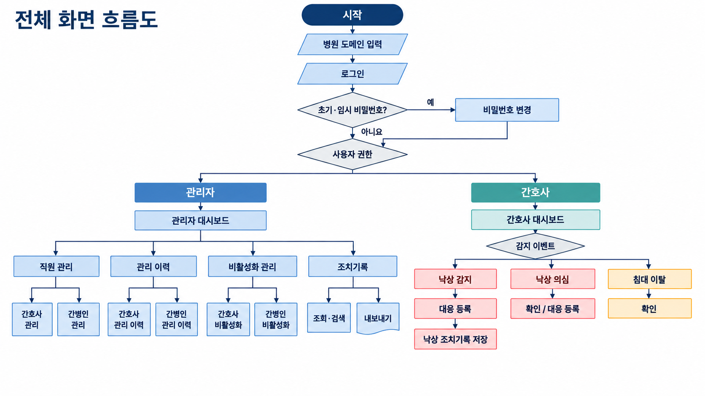
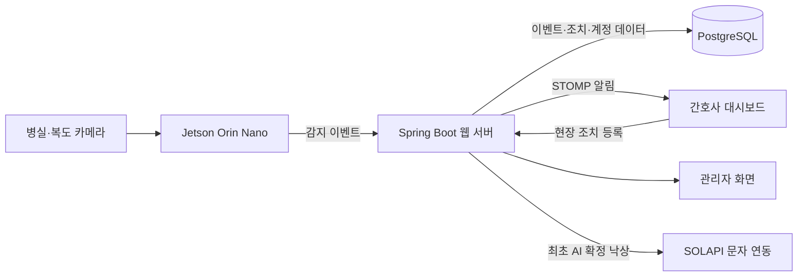

# ALLEYES

**시각지능 기반 요양병원 위험상황 감지 서비스**

ALLEYES는 요양병원에서 **낙상과 침대 이탈을 감지하고, 담당 간호사의 현장 대응까지 연결하는 서비스**입니다. Jetson이 카메라 영상에서 위험상황을 판단하면 병동 대시보드에 알림을 표시합니다. 간호사는 발생 위치와 시각을 확인하고 현장 조치 내용을 남길 수 있습니다.

**개발 팀** ALL IN ONE (5명)　·　**개발 기간** 2026.09.04–10.02

[주요 기능](#주요-기능) · [시스템 구성](#시스템-구성) · [실행 방법](#실행-방법) · [평가 결과](#평가-결과) · [팀원 및 기여](#팀원-및-기여)

## 주요 기능

| 기능 | 설명 |
| --- | --- |
| 병동 대시보드 | 간호사가 담당 병동의 **낙상 확정·낙상 의심·침대 이탈** 알림을 확인합니다. |
| 현장 확인 및 조치 기록 | 간호사가 알림을 확인하고 대응 내용을 등록합니다. 간호사와 관리자는 각자의 권한 범위에서 조치 기록을 조회합니다. |
| 사고 구간 영상 | 관리자가 조치 기록에서 연결된 사고 구간 영상을 확인할 수 있도록 구성했습니다. |
| 낙상 문자 연동 | 최초 AI 확정 낙상에 대해 병동 간호사를 발송 대상으로 선정합니다. 병실에서 발생한 경우 해당 병실에 등록된 간병인도 포함합니다. |
| 계정 및 감사로그 | 관리자가 계정 생성, 담당 병동 변경, 비밀번호 초기화, 비활성화·재활성화를 수행하고 이력을 조회합니다. 임시 비밀번호는 첫 로그인에서 변경합니다. |

<details>
<summary>간호사·관리자 화면 흐름도</summary>



</details>

## 시스템 구성



1. **엣지 추론** · YOLO11n-Pose로 관절 좌표를 추출하고 ByteTrack으로 사람을 추적합니다. 시간에 따른 자세 변화를 SVM과 판정 규칙에 적용합니다. 침대 이탈은 침대 관심 영역(ROI)을 기준으로 판단합니다.
2. **이벤트 수집** · Jetson은 `POST /api/edge/sessions`로 카메라 세션을 등록하고 `POST /api/edge/events`로 감지 결과를 전송합니다. 서버는 이벤트 ID를 기준으로 중복 요청을 처리합니다.
3. **병동별 알림** · 서버는 이벤트를 저장한 뒤 WebSocket(STOMP)으로 해당 병동에 알림을 전달합니다. 동일 사건의 반복 감지는 저장하되 대시보드와 문자에 반복 발송하지 않도록 처리합니다.

### 기술 스택

| 영역 | 기술 |
| --- | --- |
| 엣지 AI | Python, Jetson Orin Nano, YOLO11n-Pose, ByteTrack, SVM |
| 백엔드 | Java 21, Spring Boot, Spring Security, MyBatis, WebSocket(STOMP) |
| 프런트엔드 | Thymeleaf, HTML, CSS, JavaScript |
| 데이터베이스 | PostgreSQL |
| 문자·배포 | SOLAPI, XOS |
| 빌드 | Maven Wrapper |

## 실행 방법

이 저장소의 웹 서버를 실행하려면 **JDK 21**과 **기본 스키마 및 개발 데이터가 준비된 PostgreSQL**이 필요합니다. [`db/migrations/`](db/migrations/)는 기존 DB에 적용하는 변경 스크립트입니다. 팀의 기본 스키마와 개발용 병원·계정을 먼저 준비합니다.

### 1. 환경 변수 설정

| 환경 변수 | 설정 내용 |
| --- | --- |
| `DB_URL` | PostgreSQL JDBC URL. 예시 형식은 `jdbc:postgresql://localhost:5432/alleyes_dev`입니다. |
| `DB_USERNAME`, `DB_PASSWORD` | 개발용 DB 계정 정보 |
| `EDGE_API_KEY` | Jetson 연동 시 웹 서버와 장비에 설정하는 인증 키 |
| `SOLAPI_API_KEY`, `SOLAPI_API_SECRET`, `SOLAPI_SENDER_NUMBER` | 문자 연동 시 사용하는 키와 등록 발신번호 |
| `WS_ALLOWED_ORIGINS` | 필요한 경우 허용할 WebSocket 접속 출처 |

### 2. 웹 서버 실행

환경 변수를 현재 셸에 반영한 뒤 저장소 루트에서 운영체제에 맞는 명령을 실행합니다.

```powershell
.\mvnw.cmd '-Dmaven.test.skip=true' '-Dspring-boot.run.addResources=true' spring-boot:run
```

```bash
./mvnw -Dmaven.test.skip=true -Dspring-boot.run.addResources=true spring-boot:run
```

브라우저에서 `http://localhost:8081`을 열고 개발 DB에 등록된 병원 도메인과 계정으로 로그인합니다. 감지 기능을 연결하려면 Jetson용 추론 코드와 모델을 장비에 별도로 준비합니다.

### 저장소 구조

```text
src/main/java/com/aio/hospitalsafety/  서버 API, 서비스 로직, 데이터 접근
src/main/resources/mapper/           MyBatis SQL 매핑
src/main/resources/templates/        Thymeleaf 화면
src/main/resources/static/           JavaScript, CSS, 이미지
db/migrations/                       DB 변경 스크립트
docs/                                요구사항 및 화면 설계 자료
final_presentation/                  최종 발표 자료
```

## 평가 결과

아래 수치는 최종 발표에서 사용한 제한된 평가 영상과 장비 환경 기준입니다.

| 평가 항목 | 결과 |
| --- | --- |
| 낙상 확정 감지 | 14건 중 10건 |
| 정상 동작에서의 낙상 오경보 | 51건 중 3건 |
| 엣지 처리 속도 | 약 7.6 FPS |

개발 환경에서는 Jetson이 전송한 이벤트의 DB 저장과 대시보드 알림 송신을 확인했습니다. 다인 가림·야간 촬영 조건에서의 감지, 실제 문자 수신, 감지부터 현장 조치까지 이어지는 전체 흐름은 추가 검증 과제로 남아 있습니다.

[최종 발표 자료](final_presentation/ALLEYES_최종발표_최종본.pptx)

## 팀원 및 기여

| 팀원 | 역할 | 주요 기여 |
| --- | --- | --- |
| 임채현 | PM · 백엔드 | 요구사항·일정 조율, ERD·DB 설계, 관리자 계정·병동·감사로그, 간호사 대시보드 서버 연동, 팀 코드 통합 |
| 구정경 | 풀스택 | 병원 도메인 선택과 로그인·권한 처리, 관리자·직원 화면, 병동 대시보드 및 세션 처리 |
| 구예진 | 프런트엔드 | 간호사·관리자 화면, 알림·조치·영상 UI, 계정·간병인 관리 UI 및 반응형 화면 |
| 김태현 | 풀스택 | 로그인과 시도 제한 관련 기능, 로봇 모니터링 UI 시안, 시연·발표 자료 |
| 박건희 | AI 모델링 · 백엔드 | 자세 추정·낙상 판정 모델, Jetson 추론·사고 구간 영상, 이벤트 전송 및 문자 연동 |
